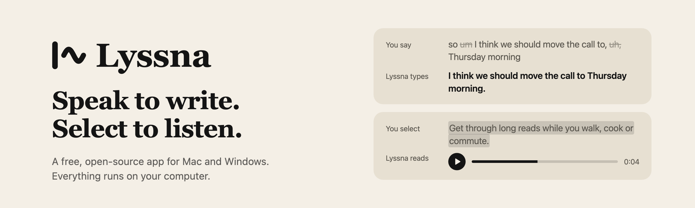
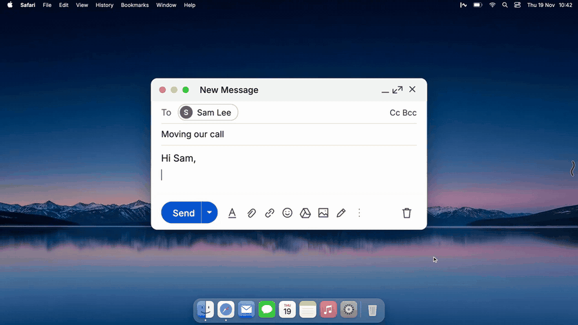

<p align="center">
  
</p>

<p align="center">
  <a href="https://github.com/andresvourakis/lyssna/releases/latest"></a>
  
  
  
  
</p>

Lyssna does two things on your Mac or Windows PC. Select text in any app, press Control-Option-S (Ctrl+Alt+S on Windows), and hear it read aloud in a natural voice. Or hold fn (Ctrl+Win on Windows) and speak, and Lyssna types what you said wherever your cursor is.

<p align="center">
  
</p>

- **A voice that sounds human.** Not the robotic system voice.
- **Dictation that cleans up.** Filler words and false starts go, punctuation goes in, and it learns the names you correct.
- **Free, and it runs on your computer.** No account, no API key, and your text and voice never leave the computer.
- **Works in any app.** Browsers, mail, PDFs, Slack, the terminal. If you can select it, Lyssna can read it. If you can type in it, Lyssna can dictate into it.
- **Open source.** GPL-3.0. Read the code, build it yourself, change it.

I built Lyssna because I wanted to listen to long articles and AI answers while I work, without paying for another subscription. It started as a personal tool, and I use it every day. Lyssna is Swedish for "listen" (say "LISS-nah").

## Install

Lyssna runs on a Mac with macOS 14 or later, and on a PC with Windows 10 or 11 (64-bit, x64).

### Mac

Paste this into Terminal and press Return:

```bash
curl -fsSL https://raw.githubusercontent.com/andresvourakis/lyssna/main/scripts/install.sh | sh
```

That downloads the latest version, checks it, puts Lyssna in your Applications folder and opens it. Run the same line again any time to update.

Prefer to download by hand? Get the zip from the [Releases page](https://github.com/andresvourakis/lyssna/releases) and follow [docs/INSTALL.md](docs/INSTALL.md). macOS will say the app "is damaged" the first time; that page has the one Terminal line that fixes it.

Lyssna runs on Apple silicon and Intel Macs. The Intel version is new and less tested, so please open an issue if something is off.

### Windows

Open PowerShell (press the Windows key, type PowerShell, press Enter), paste this line and press Enter:

```powershell
irm https://raw.githubusercontent.com/andresvourakis/lyssna/main/scripts/install.ps1 | iex
```

That downloads the latest version, checks it, puts Lyssna in `%LOCALAPPDATA%\Programs\Lyssna`, adds it to the Start menu and opens it. It needs no administrator rights. Run the same line again any time to update.

Prefer to download by hand? Get `Lyssna-<version>-windows-x64.zip` from the [Releases page](https://github.com/andresvourakis/lyssna/releases) and follow [docs/INSTALL.md](docs/INSTALL.md). Windows may say it "protected your PC" the first time, because the app is not signed; click **More info**, then **Run anyway**.

### First launch

A setup window walks you through it: allow Accessibility (on the Mac), choose a voice, allow the microphone and download the speech models. The free voice and the speech models download once (about 1.4 GB in total) and then work offline.


You can open this window again with **Setup…** in the Lyssna menu: the menu bar icon on the Mac, or the Lyssna icon by the clock on Windows.

## Using it

Select text and a small play button appears just above the selection. Click it, or use the hotkey.

| Action                   | Mac           | Windows                          |
| ------------------------ | ------------- | -------------------------------- |
| Read the selected text   | ⌃⌥S           | Ctrl+Alt+S                       |
| Pause / resume           | ⌃⌥Space       | Ctrl+Alt+Space                   |
| Stop                     | ⌃⌥X           | Ctrl+Alt+X                       |
| Next / previous sentence | ⌃⌥→ / ⌃⌥←     | Ctrl+Alt+Right / Ctrl+Alt+Left   |
| Faster / slower          | ⌃⌥= / ⌃⌥-     | Ctrl+Alt+= / Ctrl+Alt+-          |
| Play button on / off     | ⌃⌥B           | Ctrl+Alt+B                       |
| Paste last dictation     | ⌃⌥V           | Ctrl+Alt+V                       |

If nothing is selected, Control-Option-S (Ctrl+Alt+S) reads the clipboard instead. On Windows the hotkeys use the left Alt key; AltGr does not count as Alt.

**The player.** While Lyssna reads, a small floating player shows progress and lets you pause, skip by sentence and change speed. Drag it anywhere. Its tuck button sends it to the edge of the screen as a slim capsule; hover the capsule to get the controls back.

**The menu.** Click the Lyssna icon for the same controls, plus the voice, the speed and **Settings**. On the Mac the icon is in the menu bar. On Windows it is by the clock, and it may be hidden behind the small arrow there. One line in the menu always tells you where your text goes: "Text stays on this Mac" (or "on this PC") or, for example, "Text is sent to Inworld".

**The squiggle.** When nothing plays, the wave from the Lyssna logo waits on the edge of the screen. Hover it to dictate, read the selection or open the history.

<details>
<summary><strong>From the terminal</strong></summary>

The same commands drive the running app:

```bash
alias lyssna=/Applications/Lyssna.app/Contents/MacOS/Lyssna   # app install; from source it is `uv run lyssna`

lyssna "Read this sentence."
cat notes.md | lyssna -
lyssna article.md
lyssna pause | stop | next | prev | status
lyssna speed 1.5
lyssna doctor        # checks keys and permissions, then does a test reading
```

On Windows the command is `lyssna-cli.exe` in the folder Lyssna is installed in (`%LOCALAPPDATA%\Programs\Lyssna` with the one-line installer).

</details>

Hotkeys and other settings live in `~/.config/lyssna/config.toml` on the Mac and in `%APPDATA%\Lyssna\config.toml` on Windows (**Settings > Edit Config File…**). Restart Lyssna after changing hotkeys.

## Dictate

Click where you want the text, hold **fn**, speak, and let go. Lyssna types what you said, cleaned up: filler words and false starts removed, punctuation and capitals added, lists turned into lists. For a longer dictation, press **Space** while holding fn and let go of both: Lyssna keeps listening until you press fn again, and Escape cancels (Undo in the notice brings the recording back).

macOS also uses fn as the Globe key. Set **System Settings > Keyboard > Press Globe key to** to **Do Nothing**, or the emoji picker opens each time you dictate.

**On Windows**, hold **Ctrl+Win** (either Ctrl key and either Windows key) instead of fn, speak, and let go. For a longer dictation, press **Space** while holding Ctrl+Win and let go of all three, or tap Ctrl+Win twice quickly. Lyssna keeps listening until you press Ctrl+Win again, and Escape cancels.

**On your computer by default.** Speech to text runs on the Parakeet model and the cleanup on S1-mini by Superwhisper. They download once (about 1.1 GB) and then work offline. Your voice and your text stay on your computer.

**In the cloud, with your own keys.** If you dictate many names or unusual words, cloud engines do better: OpenAI or Inworld for speech to text and Claude Haiku for the cleanup. Paste your keys in **Setup…**. You pay the providers directly.

**The dictionary.** When you fix a name right after a dictation, Lyssna learns the spelling and gets it right the next time. You can add and remove words yourself in **History… > Dictionary**.

**History.** **History…** in the menu lists what you dictated, searchable, for 30 days.

## Voices

The default voice is **Kokoro**, a free model that runs on your computer. It needs no account and no key, it downloads once (about 210 MB), and after that it works offline. Pick between eight English voices (US and UK) under **Voice**.

If you want a cloud voice, bring your own API key and pay the provider directly. Choose it under **Voice Provider** and paste the key.

| Voice provider      | What you need               | Rough price per 1M characters |
| ------------------- | --------------------------- | ----------------------------- |
| Kokoro (default)    | Nothing                     | Free                          |
| macOS system voice  | Nothing                     | Free                          |
| Windows system voice | Nothing                    | Free                          |
| Inworld TTS-2       | Key from platform.inworld.ai | $25                          |
| Inworld TTS-2 Flash | The same Inworld key        | $15                           |
| Cartesia Sonic      | Key from play.cartesia.ai   | $50                           |
| ElevenLabs          | Key from elevenlabs.io      | $100 (eleven_v3)              |
| OpenAI TTS          | Key from platform.openai.com | $12 (gpt-4o-mini-tts)        |

A heavy reader (roughly five hours of listening a month) pays a few dollars a month with Inworld or OpenAI. Prices change; check the provider. For a quality and price comparison, see [docs/VOICES.md](docs/VOICES.md).

## Privacy

- With the local voice (Kokoro) or the system voice of macOS or Windows, your text never leaves the computer.
- With a cloud voice, each sentence is sent over HTTPS to that provider, using your own key, under that provider's terms.
- Dictation on your computer keeps your voice and text there. With a cloud engine, the recording goes to OpenAI (or Inworld) and the text to Anthropic, with your own keys.
- The microphone is on only while you dictate. Recordings stay in memory and are never saved. Dictated text is kept in the history for 30 days.
- API keys are stored in the macOS Keychain, or in Windows Credential Manager on Windows.
- No analytics, no telemetry, no update checks. The log records lengths and timings, never your text.
- Full details, with every file path: [PRIVACY.md](PRIVACY.md).

## For work computers

- **Keep everything on this computer.** Turn on **Settings > Keep Everything on This Mac** (**Keep Everything on This PC** on Windows), or set `local_only = true` in the config file. Every cloud voice and every cloud dictation engine is hidden and blocked.
- **Enforce it.** On a Mac, an administrator can set the managed preference `LocalOnly` to true in the domain `io.github.andresvourakis.lyssna` (for example with a configuration profile from your MDM). On Windows, an administrator can set the DWORD value `LocalOnly` to 1 under `Software\Policies\Lyssna` in `HKEY_LOCAL_MACHINE` or `HKEY_CURRENT_USER` (for example with Group Policy). Users cannot turn it off.
- **Company OpenAI gateway.** If your company provides an OpenAI-compatible endpoint, set `base_url` under `[openai]` in the config file (for example `base_url = "https://gateway.example.com/v1"`; it must be https) and add the key your company gave you. Reading and dictation with OpenAI both use it, and the menu lines name that host as the place your text and speech go.

## Troubleshooting

**The hotkey does nothing (Mac).** Lyssna does not have Accessibility access. The menu bar icon shows a warning and the menu has **Allow Accessibility Access…**. Turn on Lyssna in System Settings > Privacy & Security > Accessibility, then relaunch it. If it is already on after an update, turn it off and on again, or remove Lyssna with the minus button and add it back.

**"Windows protected your PC" after a manual download on Windows.** The app is not signed, so Windows SmartScreen warns about it. Click **More info**, then **Run anyway**.

**"Lyssna is damaged and can't be opened" after a manual download.** The app is not damaged. Click Cancel, then paste `xattr -dr com.apple.quarantine /Applications/Lyssna.app` into Terminal and open Lyssna again. macOS shows this for downloaded apps that are not notarized by Apple, which needs a paid Apple developer membership. The one-line installer avoids the message.

**Holding fn opens the emoji picker.** Set **System Settings > Keyboard > Press Globe key to** to **Do Nothing**. The setup window has a button that opens that page.

**Dictation types nothing.** On the Mac, check that Lyssna may use the microphone in System Settings > Privacy & Security > Microphone. On Windows, check that microphone access and desktop apps' access to the microphone are on in Settings > Privacy & security > Microphone. When no text field is in front, the text is left on the clipboard instead; press Command-V (Ctrl+V on Windows) to paste it.

**Where is the log?** In the Lyssna menu, **Settings > Open Log**. The file is `~/Library/Logs/Lyssna/lyssna.log` on the Mac and `%LOCALAPPDATA%\Lyssna\Logs\lyssna.log` on Windows. Include the relevant lines when you [open an issue](https://github.com/andresvourakis/lyssna/issues).

## Build from source

You need Python 3.11 or later and [uv](https://docs.astral.sh/uv/).

```bash
uv sync          # install dependencies
make test        # run the tests
make run         # run the menu bar app from source
make app         # build Lyssna.app and the release zip
```

Run `make` to list every target. From source, macOS asks for Accessibility for your terminal app, not for Lyssna.

The Windows app is built on Windows: `uv sync --group build`, then `uv run python scripts/make_icon_win.py` and `uv run pyinstaller lyssna-win.spec --noconfirm`. The app lands in `dist\Lyssna`. GitHub builds it the same way in `.github/workflows/windows-build.yml`. See [CONTRIBUTING.md](CONTRIBUTING.md) before opening a pull request.

## How it works

<details>
<summary>A short tour of the code</summary>

```
cli.py ──socket──▶ controller.py ◀── app.py (menu bar or tray, hotkeys, mouse gestures)
                        │                │
                     player.py        ui/ (selection_button, mini_player, panel)
                        │
          providers/ + cache.py + keystore.py
```

- `controller.py` owns playback and exposes every action once. The menu bar, hotkeys, floating player and the command line all call it.
- `mac/events.py` has the keyboard tap for hotkeys and a listen-only mouse tap that spots selection gestures. `selection.py` shows the play button only on proof that text was selected: a new selection reported through Accessibility, or a copy on select.
- `mac/capture.py` reads the selection through the Accessibility API first. Only where an app does not expose it does it send Command-C, then put the whole previous clipboard back.
- `text.py` strips markdown, code fences, URLs, tables and hashtags, then splits the text into sentences.
- `player.py` synthesizes up to four sentences ahead with two parallel requests, so stopping early does not pay for the rest, and plays them with AVAudioPlayer on the Mac (`mac/audio.py`) and Qt's audio output on Windows (`win/audio.py`). Speed changes are time-stretched with pitch preserved.
- `providers/` has one small class per voice provider. `providers/kokoro.py` runs the local voice and `download.py` fetches its model files once, with pinned hashes.
- `cache.py` keeps synthesized audio in `~/Library/Caches/Lyssna` (`%LOCALAPPDATA%\Lyssna\Cache` on Windows), so reading the same text again is free and instant.
- `dictation/` turns speech into text: `recorder.py` records in memory, `pipeline.py` runs a speech engine (`transcribers/`) and a cleanup engine (`cleaners/`), `insert.py` pastes the result, `vocabulary.py` and `learn.py` keep the dictionary, and `history.py` keeps the history.
- `keystore.py` stores API keys in the macOS Keychain (through `mac/credentials.py`) or in Windows Credential Manager (through `win/credentials.py`) and reads them at launch on a background thread. `migrate.py` carries over settings from the app's earlier name.
- `mac/ipc.py` is a Unix socket (`win/ipc.py` a named pipe on Windows), so the command line and the app share one player.
- `host.py` picks the Mac modules in `mac/` or their Windows twins in `win/`; the rest of the code reaches the system only through it.

</details>

## License

Lyssna is licensed under the GNU General Public License, version 3 or later. See [LICENSE](LICENSE). The app bundles components under their own licenses; see [THIRD_PARTY_NOTICES.md](THIRD_PARTY_NOTICES.md).

Lyssna is not affiliated with any other product or company of the same name.
