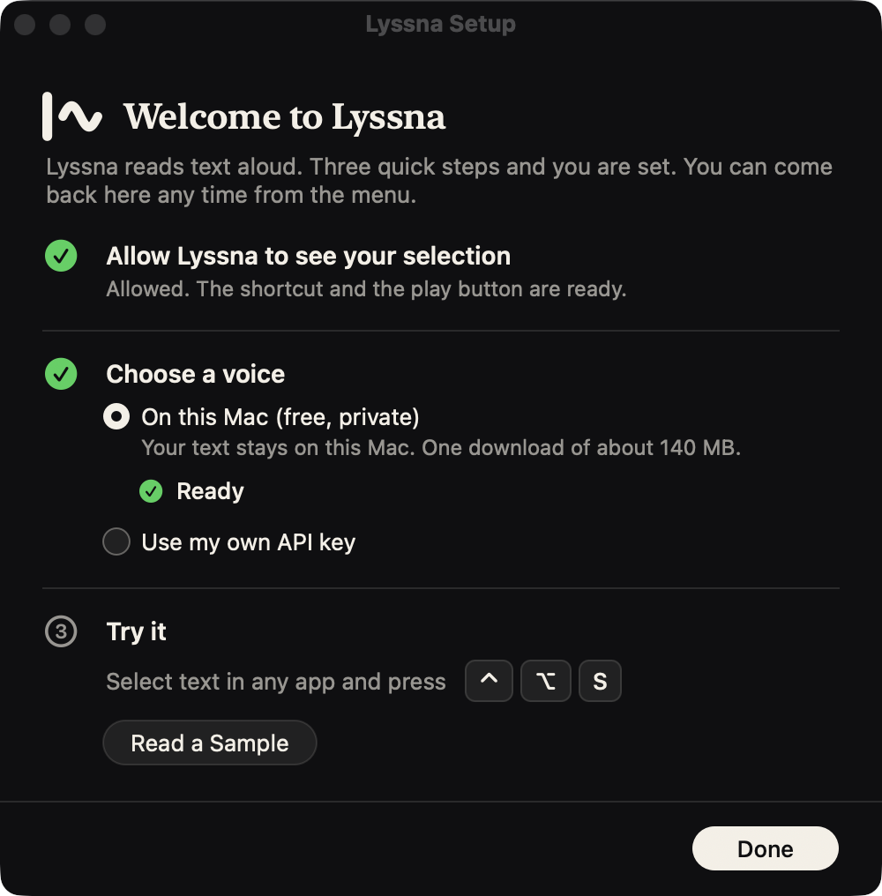

<p align="center">
  <picture>
    <source media="(prefers-color-scheme: dark)" srcset="docs/images/logo-light.png">
    
  </picture>
</p>

# Lyssna

Lyssna does two things on your Mac. Select text in any app, press Control-Option-S, and hear it read aloud in a natural voice. Or hold fn and speak, and Lyssna types what you said wherever your cursor is.

Lyssna is Swedish for "listen" (say "LISS-nah").

- **A voice that sounds human.** Not the robotic system voice.
- **Dictation that cleans up.** Filler words and false starts go, punctuation goes in, and it learns the names you correct.
- **Free and private by default.** The voice and dictation run on your Mac. No account, no API key, and your text and voice never leave the computer.
- **Works in any app.** Browsers, mail, PDFs, Slack, the terminal. If you can select it, Lyssna can read it. If you can type in it, Lyssna can dictate into it.
- **Open source.** GPL-3.0. Read the code, build it yourself, change it.

<!-- Demo GIF goes here: docs/images/demo.gif (select text, press the hotkey, the player appears) -->

I built Lyssna because I wanted to listen to long articles and AI answers while I work, without paying for another subscription. It started as a personal tool, and I use it every day.

## Install

Paste this into Terminal and press Return:

```bash
curl -fsSL https://raw.githubusercontent.com/andresvourakis/lyssna/main/scripts/install.sh | sh
```

That downloads the latest version, checks it, puts Lyssna in your Applications folder and opens it. Run the same line again any time to update.

Prefer to download by hand? Get the zip from the [Releases page](https://github.com/andresvourakis/lyssna/releases) and follow [docs/INSTALL.md](docs/INSTALL.md). macOS will show a "cannot verify" warning the first time; that page explains the one-time fix.

You need macOS 14 or later on an Apple silicon Mac, or macOS 13 or later on an Intel Mac. The built-in voice is a one-time 140 MB download, and dictation on your Mac a one-time 1.1 GB download (about 660 MB on Intel, where dictation cleans up with simple rules instead of a model). The Intel version is new and less tested, so please open an issue if something is off.

### First launch

1. **Allow Accessibility.** The setup window asks for it. Turn on Lyssna in System Settings > Privacy & Security > Accessibility, then click **Relaunch Lyssna**. Lyssna needs this to read the text you select and to hear its hotkeys.
2. **Choose a voice.** The free local voice is already selected. It downloads once (about 140 MB) and then works offline. You can also paste an API key for a cloud voice.
3. **Try it.** Select some text anywhere and press Control-Option-S.
4. **Dictate.** Allow the microphone, set the Globe key to do nothing (the window shows how), and download the speech models, or paste your own keys for the online engines.



You can open this window again from the menu bar with **Setup…**.

## Using it

Select text and a small play button appears just above the selection. Click it, or use the hotkey.

The button shows only when Lyssna can tell that you selected text: the app reports a new selection, or it copies what you select (as terminal apps do). An app that does neither gets no button; the hotkey still reads your selection there.

| Action                   | Hotkey        |
| ------------------------ | ------------- |
| Read the selected text   | ⌃⌥S           |
| Pause / resume           | ⌃⌥Space       |
| Stop                     | ⌃⌥X           |
| Next / previous sentence | ⌃⌥→ / ⌃⌥←     |
| Faster / slower          | ⌃⌥= / ⌃⌥-     |
| Play button on / off     | ⌃⌥B           |

If nothing is selected, Control-Option-S reads the clipboard instead.

**The player.** While Lyssna reads, a small floating player shows progress. Drag the bar to jump around, skip by sentence, pause, change speed, or stop. Drag the player anywhere. Drop it on the left or right edge of the screen and it tucks in as a slim capsule; hover it to get the controls back. It remembers where you left it.

**The menu bar.** Click the Lyssna icon for the same controls, plus the voice, the speed and **Settings**. One line in the menu always tells you where your text goes: "Text stays on this Mac" or, for example, "Text is sent to Inworld".

Recording your screen? Press Control-Option-B or untick **Settings > Play Button on Selection** and the button stays hidden until you turn it back on.

**The squiggle.** When nothing plays, the wave from the Lyssna logo waits on the edge of the screen. It stays out of sight until your cursor comes near its spot, then slides in; hover it to dictate, read the selection or open the history. Untick **Settings > Auto-hide Squiggle** to keep it in view, and **Settings > Squiggle Wave** to keep it still.

<details>
<summary><strong>From the terminal</strong></summary>

The same commands drive the running app:

```bash
alias lyssna=/Applications/Lyssna.app/Contents/MacOS/Lyssna   # app install; from source it is `uv run lyssna`

lyssna "Read this sentence."
cat notes.md | lyssna -
lyssna article.md
lyssna pause | stop | next | prev | status
lyssna speed 1.5
lyssna doctor        # checks keys and permissions, then does a test reading
```

</details>

Hotkeys and other settings live in `~/.config/lyssna/config.toml` (**Settings > Edit Config File…**). Restart Lyssna after changing hotkeys.

## Dictate

Click where you want the text, hold **fn**, speak, and let go. Lyssna types what you said, cleaned up: filler words and false starts removed, punctuation and capitals added, lists turned into lists. For a longer dictation, press **Space** while holding fn and let go of both: Lyssna keeps listening until you press fn again, and Escape cancels (Undo in the notice brings the recording back).

macOS also uses fn as the Globe key. Set **System Settings > Keyboard > Press Globe key to** to **Do Nothing**, or the emoji picker opens each time you dictate.

**On your Mac by default.** Speech to text runs on the Parakeet model and the cleanup on S1-mini by Superwhisper. They download once (about 1.1 GB) and then work offline. Your voice and your text stay on the Mac.

**Online, with your own keys.** If you dictate many names or unusual words, the online engines do better: OpenAI for speech to text and Claude Haiku for the cleanup. Paste your keys in **Setup…**: each is checked with a request that costs nothing, then saved, and dictation switches to that engine. **Transcription** and **Cleanup** in the menu switch between engines. You pay the providers directly.

**The dictionary.** When you fix a name right after a dictation, Lyssna learns the spelling and gets it right the next time. You can add and remove words yourself in **History… > Dictionary**. Set `auto_learn = false` under `[dictation]` in the config file to stop the learning.

**History.** **History…** in the menu lists what you dictated, searchable, for 30 days. Copy an entry, see what the speech model heard, or fix a word. `history_days` under `[dictation]` changes how long entries are kept (0 keeps none).

## Voices

The default voice is **Kokoro**, a free model that runs on your Mac. It needs no account and no key, it downloads once (about 140 MB), and after that it works offline. Pick between eight English voices (US and UK) under **Voice**.

If you want a cloud voice, bring your own API key and pay the provider directly. Choose it under **Voice Provider** (or **Settings > API Keys**) and paste the key. Lyssna tests the key with a short reading before it saves it. **Settings > API Keys** also removes a saved key.

| Voice provider      | What you need               | Rough price per 1M characters |
| ------------------- | --------------------------- | ----------------------------- |
| Kokoro (default)    | Nothing                     | Free                          |
| macOS system voice  | Nothing                     | Free                          |
| Inworld TTS-2       | Key from platform.inworld.ai | $25                          |
| Inworld TTS-2 Flash | The same Inworld key        | $15                           |
| Cartesia Sonic      | Key from play.cartesia.ai   | $50                           |
| ElevenLabs          | Key from elevenlabs.io      | $100 (eleven_v3)              |
| OpenAI TTS          | Key from platform.openai.com | $12 (gpt-4o-mini-tts)        |

A heavy reader (about 300,000 characters a month, roughly five hours of listening) pays a few dollars a month with Inworld or OpenAI. Once you use a paid voice, the menu shows a running cost estimate for the month. Prices change; check the provider. For a quality and price comparison, see [docs/VOICES.md](docs/VOICES.md).

## Privacy

- With the local voice (Kokoro) or the macOS voice, your text never leaves the Mac.
- With a cloud voice, each sentence is sent over HTTPS to that provider, using your own key, under that provider's terms.
- Dictation on your Mac keeps your voice and text there. With an online engine, the recording goes to OpenAI (or Inworld) and the text to Anthropic, with your own keys.
- The microphone is on only while you dictate. Recordings stay in memory and are never saved. Dictated text is kept in the history for 30 days.
- API keys are stored in the macOS Keychain.
- No analytics, no telemetry, no update checks. The log records lengths and timings, never your text.
- Full details, with every file path: [PRIVACY.md](PRIVACY.md).

## For work computers

- **Keep everything on this Mac.** Turn on **Settings > Keep Everything on This Mac** (or set `local_only = true` in the config file). Every cloud voice and every online dictation engine is hidden and blocked.
- **Enforce it.** An administrator can set the managed preference `LocalOnly` to true in the domain `io.github.andresvourakis.lyssna` (for example with a configuration profile from your MDM). Users cannot turn it off.
- **Company OpenAI gateway.** If your company provides an OpenAI-compatible endpoint, set `base_url` under `[openai]` in the config file (for example `base_url = "https://gateway.example.com/v1"`; it must be https) and add the key your company gave you. Reading and dictation with OpenAI both use it, and the menu lines name that host as the place your text and speech go.

## Troubleshooting

**The hotkey does nothing.** Lyssna does not have Accessibility access. The menu bar icon shows a warning and the menu has **Allow Accessibility Access…**. Turn on Lyssna in System Settings > Privacy & Security > Accessibility, then relaunch it. If it is already on after an update, turn it off and on again, or remove Lyssna with the minus button and add it back.

**No sound.** Check your Mac's output device and volume. The first reading with the local voice waits for its download; the menu bar shows "Downloading voice" with a percentage until it is done. Errors show briefly in the menu bar. The log records which voice provider failed and how, without the message.

**"Lyssna cannot be verified" after a manual download.** Open System Settings > Privacy & Security, scroll down, and click **Open Anyway** next to the Lyssna message. This happens because Lyssna is not notarized by Apple, which needs a paid Apple developer membership. The one-line installer avoids the warning.

**Holding fn opens the emoji picker.** Set **System Settings > Keyboard > Press Globe key to** to **Do Nothing**. The setup window has a button that opens that page.

**Dictation types nothing.** Check that Lyssna may use the microphone in System Settings > Privacy & Security > Microphone. When no text field is in front, the text is left on the clipboard instead; press Command-V to paste it.

**The voice download failed.** The built-in voice is downloaded from GitHub. Check your connection, or ask whether your network blocks GitHub downloads, then read something again. The download picks up where it stopped.

**Where is the log?** Menu bar > **Settings > Open Log**, or `~/Library/Logs/Lyssna/lyssna.log`. Include the relevant lines when you [open an issue](https://github.com/andresvourakis/lyssna/issues).

## Build from source

You need Python 3.11 or later and [uv](https://docs.astral.sh/uv/).

```bash
uv sync          # install dependencies
make test        # run the tests
make run         # run the menu bar app from source
make app         # build Lyssna.app and the release zip
```

Run `make` to list every target. From source, macOS asks for Accessibility for your terminal app, not for Lyssna. See [CONTRIBUTING.md](CONTRIBUTING.md) before opening a pull request.

## How it works

<details>
<summary>A short tour of the code</summary>

```
cli.py ──socket──▶ controller.py ◀── app.py (menu bar, hotkeys, mouse gestures)
                        │                │
                     player.py        ui/ (selection_button, mini_player, panel)
                        │
          providers/ + cache.py + keychain.py
```

- `controller.py` owns playback and exposes every action once. The menu bar, hotkeys, floating player and the command line all call it.
- `events.py` has the keyboard tap for hotkeys and a listen-only mouse tap that spots selection gestures. `selection.py` shows the play button only on proof that text was selected: a new selection reported through Accessibility, or a copy on select.
- `capture.py` reads the selection through the Accessibility API first. Only where an app does not expose it does it send Command-C, then put the whole previous clipboard back.
- `text.py` strips markdown, code fences, URLs, tables and hashtags, then splits the text into sentences.
- `player.py` synthesizes up to four sentences ahead with two parallel requests, so stopping early does not pay for the rest, and plays them with AVAudioPlayer. Speed changes are time-stretched with pitch preserved.
- `providers/` has one small class per voice provider. `providers/kokoro.py` runs the local voice and `download.py` fetches its model files once, with pinned hashes.
- `cache.py` keeps synthesized audio in `~/Library/Caches/Lyssna`, so reading the same text again is free and instant.
- `dictation/` turns speech into text: `recorder.py` records in memory, `pipeline.py` runs a speech engine (`transcribers/`) and a cleanup engine (`cleaners/`), `insert.py` pastes the result, `vocabulary.py` and `learn.py` keep the dictionary, and `history.py` keeps the history.
- `keychain.py` stores API keys in the macOS Keychain and reads them at launch on a background thread. `migrate.py` carries over settings from the app's earlier name.
- `server.py` is a Unix socket, so the command line and the menu bar app share one player.

</details>

## License

Lyssna is licensed under the GNU General Public License, version 3 or later. See [LICENSE](LICENSE). The app bundles components under their own licenses; see [THIRD_PARTY_NOTICES.md](THIRD_PARTY_NOTICES.md).

Lyssna is not affiliated with any other product or company of the same name.
